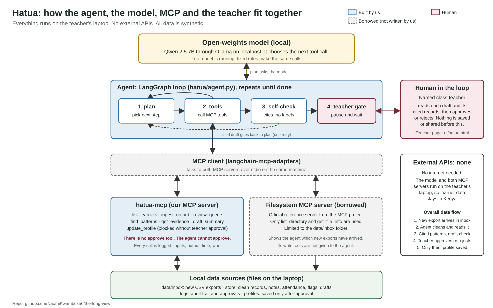

# Hatua

*Hatua kwa hatua* means "step by step" in Kiswahili. Hatua is an open-source AI agent that helps a Kenyan junior school teacher see each learner's strengths and struggles across Grades 4 to 9. Every statement links to the record it came from. Nothing is saved or shared until a named teacher approves it.

Built for the **Education: The Long View** track of the African Agentic AI Design Challenge. Sub-theme: *Longitudinal strength tracking*, with *Plain-language reporting* in English and Kiswahili.

> All data in this repository is **synthetic**. No real learner is represented.



## Problem statement

Under Kenya's Competency-Based Curriculum (CBC), teachers record many marks and notes for each learner every term. These records sit in different places. Some are in a national portal that only the head teacher can open. Some are on paper with teachers who have moved school.

A class teacher with 40 to 70 learners cannot see one child's story over many years. This matters because school-based marks now count towards a learner's Grade 9 result and senior school placement. Junior schools are short of about 72,000 teachers, so teachers change often and have little time. A slow decline in Maths, or a steady strength in making things, can go unseen until it is too late to talk with the family.

## Solution overview

The teacher puts a new export of marks in a folder. The agent:

1. looks in the folder and cleans the new records (spellings, missing terms, duplicates, late uploads)
2. finds patterns across many terms, for example "Maths went down over six terms"
3. writes a short draft for the teacher, where every statement cites the exact record behind it
4. checks its own draft, then stops and waits for the teacher

Only a named teacher can approve a draft. After approval, Hatua can write a short message for the guardian in English or Kiswahili. Hatua never picks a subject path or career for a child, never gives a label, and never compares a child with classmates.

## Target users

- **Class teachers** of Grades 7 to 9 in Kenyan public schools. They use Hatua to prepare for talks with families.
- **Learners and guardians** benefit. They get clear, sourced information, and the decision stays with them and the teacher.
- **Head teachers** can check the audit log to see what was done and who approved it.

## Architecture

```
new CSV export ─► agent (LangGraph): plan ─► tools ─► self-check ─► teacher gate ─► save
                      │                        │
        local model (Qwen via Ollama)    MCP client ─► hatua-mcp (ours, 7 tools)
        or fixed rules if none running              └► filesystem server (borrowed)
```

Everything runs on the teacher's laptop. See [ARCHITECTURE.md](ARCHITECTURE.md) and the diagram above.

## Agent architecture

- **Orchestration:** a LangGraph loop with four steps: `plan`, `tools`, `self_check`, `teacher_gate`.
- **Model:** an open-weights model (Qwen 2.5 7B) runs locally through Ollama and chooses the next tool call. If Ollama is not running, a fixed rules planner makes the same calls, so the demo always works.
- **Self-check:** every draft is re-checked for missing or false citations and for labelling words. A failed draft goes back to the planner once.
- **Memory and data:** local JSON files for records, notes, attendance, flags and drafts. Nothing is sent outside the laptop.
- **Pause:** the graph uses a LangGraph interrupt and waits for the teacher.

Patterns and drafts come from fixed rules, not from the model. The model decides which tools to call. So a claim about a learner never depends on what the model happened to write.

## MCP implementation

An MCP client (`langchain-mcp-adapters`) starts two MCP servers over stdio on the same machine and gives their tools to the agent.

## MCP tools and servers

**`hatua-mcp`: our own server** (`python -m hatua.mcp_server`). Seven tools:

| Tool | What it does |
|---|---|
| `list_learners` | Class list, with search and stream filter. Never sorted by results. |
| `ingest_record` | Cleans and adds a CSV export. Returns data-quality flags. |
| `review_queue` | Learners with new records and a pattern still going on. |
| `find_patterns` | Cited patterns across terms for one learner. |
| `get_evidence` | Opens any cited record, note or attendance entry. |
| `draft_summary` | Creates a draft for teacher review. |
| `update_profile` | Saves an approved draft. **Blocked** without a matching teacher approval. |

There is **no approve tool**. The agent cannot approve its own work. Every call is logged to `logs/audit.jsonl`.

**Filesystem MCP server: borrowed.** This is the official `@modelcontextprotocol/server-filesystem`, limited to `data/inbox`. The agent uses `list_directory` to see which new exports have arrived. We use it because it is a reviewed reference server that already enforces the folder limit. Its write tools are not given to the agent.

## Human-in-the-loop workflow

1. The agent drafts and checks. Then the graph pauses.
2. The teacher reads each draft and opens the cited records.
3. The teacher edits if needed, then approves or rejects. Approval needs a full name and is stored with a hash of the exact approved text.
4. Only then can `update_profile` save to the learner's profile.
5. A guardian message can only be drafted after the teacher approves, and it needs a second "share" approval.

A guard blocks pathway or career advice, labels, rankings and comparisons with classmates. It also checks the teacher's own edits.

## Technology stack

Python, LangGraph, `langchain-mcp-adapters`, the MCP Python SDK, Ollama with Qwen 2.5 7B, Node.js (for the borrowed server), and plain HTML and JavaScript for the teacher page. No external APIs. No database server: data is stored in local files.

## Setup and installation

**Quick look (needs only Python 3.9+, nothing to install):**

```bash
git clone https://github.com/NaomiKwamboka0/the-long-view.git
cd the-long-view
python3 -m hatua demo
open ui/hatua.html        # on Windows or Linux, open the file in a browser
```

**Run the agent (Python 3.10+, Node.js and Ollama). On a Mac:**

```bash
brew install python@3.12 node ollama
brew services start ollama
ollama pull qwen2.5:7b            # one-time download, about 4.7 GB
python3.12 -m venv .venv && source .venv/bin/activate
pip install -r requirements.txt
python -m hatua setup
python -m hatua agent
```

## Usage

| Command | What it does |
|---|---|
| `python -m hatua demo` | Load the synthetic class, take in this term's export, build the teacher page |
| `python -m hatua agent` | Run the agent. It pauses and asks for the teacher's name and decisions. |
| `python -m hatua agent --rules` | Same, but plan with fixed rules instead of the model |
| `python -m hatua agent --max 5` | Draft for up to 5 learners (default 3) |
| `python -m hatua patterns HT-0003` | Show cited patterns for one learner |
| `python -m hatua draft HT-0003` | Draft a summary for the class teacher |
| `python -m hatua approve D-xxxx --teacher "Full Name"` | Teacher approves (add `--reject`, `--edited file.txt`, `--share`) |
| `python -m hatua build-ui` | Rebuild the teacher page `ui/hatua.html` |
| `python -m hatua import-approvals approvals.json` | Apply approvals made on the teacher page |
| `python scripts/run_evals.py` | Run the evaluation tasks |

**The teacher page** (`ui/hatua.html`) works offline. Search learners by name or ID with the Search button, and filter by stream, learning area, what the records show, review status and data issues. Open a learner to see the Grade 4 to 9 long view, the cited patterns and the draft. Tap any cell or citation to open the record behind it. The page also has a **Data checks** list and an **Activity log**, each with its own search and filters.

## Evaluation

`python scripts/run_evals.py` runs 20 fixed tasks: 16 for the engine and 4 for the agent. 19 pass. One known failure is documented. See [EVALS.md](EVALS.md).

## Limitations

- **The real local model has not been run end to end yet.** The model path is built and tested with a scripted stand-in model, but the run with Qwen on a laptop still has to be measured.
- **No real school has tested it.** All data is synthetic, written by us. The test cases check that the rules do what we meant, not that teachers find them useful.
- **Known failure:** a pattern can start or end on a record whose score and level disagree. It is flagged, but still reported. See EVALS.md.
- **No bid or exam documents:** Hatua uses marks, notes and attendance. It does not read the national exam portals, and no public API for them was found.
- The score bands used when a rubric level is missing (EE from 75%, ME from 50%, AE from 25%) are our assumption.
- Kiswahili messages use fixed templates. A native speaker should review them.

## Future improvements

- Run and measure the agent with Qwen over many runs.
- Treat a record with a score and level conflict as unconfirmed, and shrink the pattern window past it.
- Test with a junior school teacher, then change the patterns and wording to match what teachers find useful.
- Have a Kiswahili speaker review all guardian messages.
- A Data Protection Impact Assessment and written consent steps before any real pilot, as Kenya's Data Protection Act requires for children's data.
- Import from real school exports, with parental consent.

## Licence

MIT. See [LICENSE](LICENSE).
