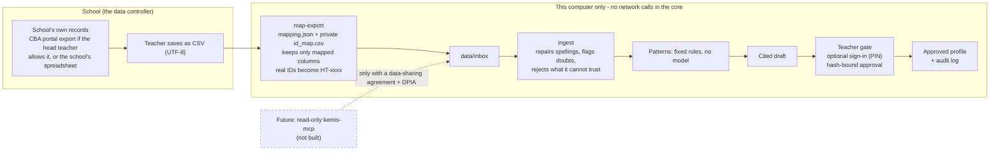

# How data reaches Hatua, and where national systems fit

Hatua does not read any national system. It reads a CSV that a teacher or school already holds,
cleans it on that computer, and finds patterns with fixed rules. A named teacher approves every
output. This page shows each step, what stays local, and the conditions for a future link to a
national system.

## Step by step

| Step | Who | What happens | Stays on the school's device? |
|---|---|---|---|
| 1. Export | Teacher or head teacher | Save the school's own records as CSV. | Yes |
| 2. Map | Teacher, once per sheet layout | `python -m hatua map-export file.csv --mapping data/mappings/<yours>.json`. Only columns named in the mapping are copied. Unmapped columns are dropped and listed. Headings that look like names, phones, guardians, health or birth details are called out. | Yes |
| 3. Pseudonymise | Teacher, optional | If the mapping names an `id_map`, real admission numbers become `HT-xxxx`. A real ID missing from the map is skipped, never passed through. The map lives in `data/private/`, which git ignores. | Yes |
| 4. Ingest | Teacher | `python -m hatua ingest <file>` repairs level, area, date and ID spellings, and records every repair or doubt as a flag. Conflicts are excluded from patterns. | Yes |
| 5. Review | Teacher | Patterns and drafts cite the records they came from. Nothing is saved or shared until a named teacher approves. | Yes |

Start from `docs/templates/records_template.csv` and `data/mappings/example_school_export.json`.

## What is not assumed

- **No API.** No public API for the national assessment portals was found. Hatua works from exports.
- **Export layout is unverified.** The mapper exists because real exports will not match Hatua's columns. Check one real, anonymised export against a mapping before a pilot.
- **Free-text notes are the highest-risk field.** They can hold health or family details. Teachers should not put such details in notes that Hatua will read.

## NEMIS, KEMIS and a future connection

Reports in 2025-26 describe KEMIS replacing NEMIS, with a planned open API layer. In September 2026 the
ministry told a parliamentary committee that KEMIS was still being finalised and that recent
capitation used field-verified data
([Citizen Digital](https://citizen.digital/article/education-ps-grilled-over-replacement-of-nemis-in-school-capitation-n389119);
[The Star, 2025](https://www.the-star.co.ke/news/2025-05-15-kemis-is-coming-state-to-track-learners-from-nursery-to-varsity)).
The situation is changing, so verify it before relying on it.

Hatua's position is deliberate: it sits beside national systems, not inside them. It is decision
support for one teacher, not a system of record, and it never writes back.

A future connection would be a **read-only MCP server** next to `hatua-mcp`. The agent would not
change; only the source of the CSV would. Conditions before building it:

1. A written data-sharing agreement with the Ministry (see the ODPC Data Sharing Code).
2. A completed DPIA (`docs/DPIA.md` is the starting draft).
3. Read-only access, scoped to one authenticated teacher's own class, with credentials held outside the repository.
4. Only the fields Hatua uses: assessment records and attendance for that class.
5. Every call logged, as with the existing tools.
6. No hosted model: learner data stays on the school's computer.
