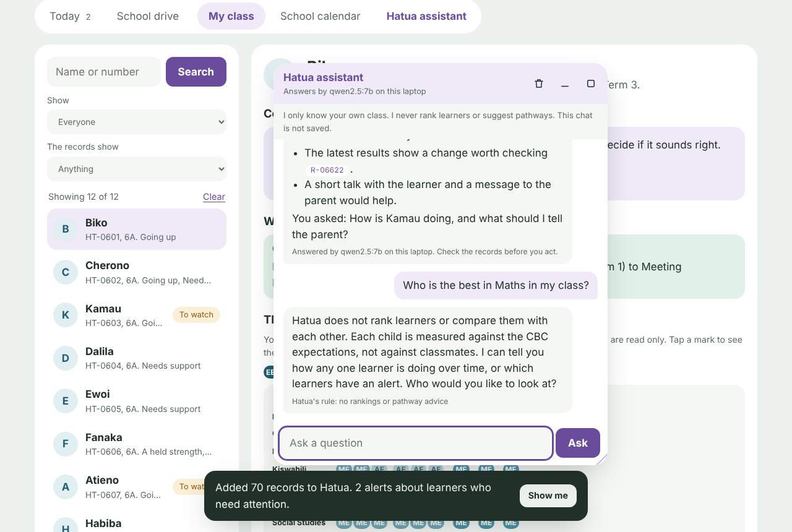
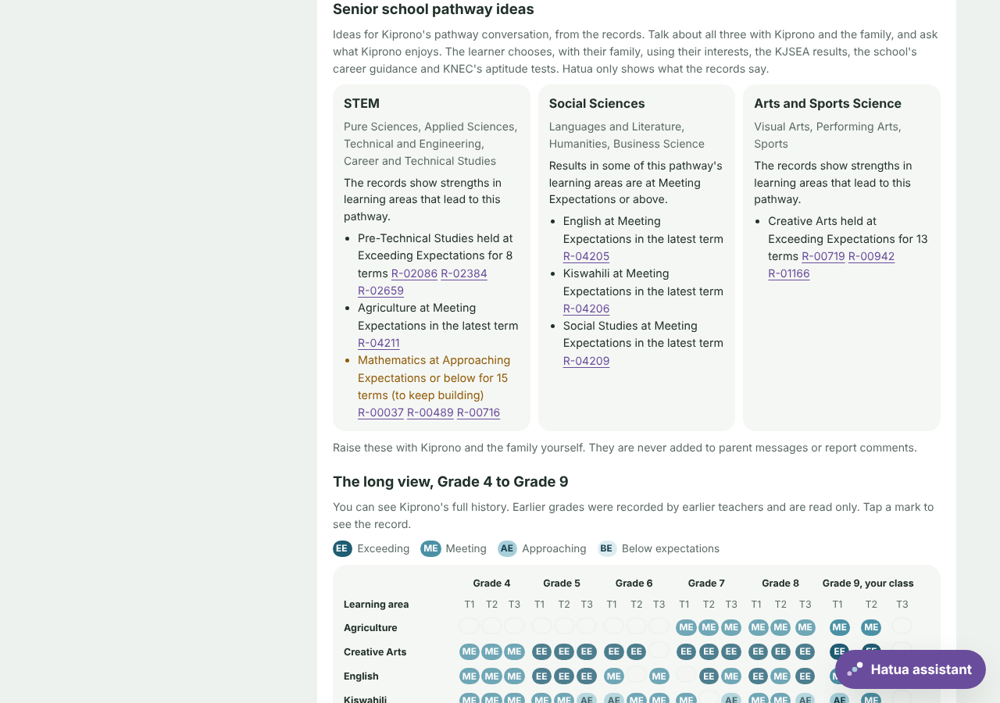

# The teacher portal (whole-school demo)

The portal is a small web page that runs on the teacher's own laptop. Each class teacher signs in with their **member number** and a PIN. They see only their own class, with the full Grade 4 to 9 history of each learner.

Everything in the demo is invented: the school, the 7 teachers and the 100 learners.

## Try it

```
python -m hatua school-demo
```

Then open **http://127.0.0.1:8765** in a browser. The sign-in page lists the practice accounts. All of them use the PIN `246810`.

| Member number | Teacher | Class | What you will see |
|---|---|---|---|
| M-4001 | Grace Wambui | Grade 4A | Term 3 already approved. Wanjiku (HT-0405) dropped in Kiswahili: an early warning. |
| M-5001 | Peter Otieno | Grade 5A | Term 3 file waiting for approval. |
| M-6001 | Mary Njeri | Grade 6A | Term 3 file waiting. After approval: Kamau (HT-0603) fell two levels in Mathematics, and Atieno (HT-0607) has gone down in English over several terms. |
| M-7001 | John Kiprop | Grade 7A | **No Term 3 file yet**, so the portal says the results are overdue. Upload `demo_school/samples/grade7_2026_term3_results.csv` to try it. |
| M-8001 | Ruth Mwende | Grade 8A | Term 3 file waiting. After approval: Nyokabi (HT-0805) fell in Science. |
| M-9001 / M-9002 | Daniel Mutiso / Agnes Chepkoech | Grade 9A / 9B | One shared Grade 9 file. Each teacher approves only their own stream's rows. |

The demo's date is fixed at 4 November 2026, after Term 3 closed, so Term 3 results are due. Set `HATUA_TODAY` to try another date.

## What a teacher can do

**Today.** What needs the teacher now:
- results that are overdue or waiting for approval;
- learners to watch, grouped by learner;
- for each learner, **Message for the parent**: a short message in English or Kiswahili to copy and send. Hatua sends nothing. The teacher then ticks **I have told the parent** and says how (SMS, WhatsApp, phone call, in person, a note). That way every teacher knows what has already been said.

**School drive.** The class's folders on the school's shared drive, divided by grade and term:

```
school_drive/Grade 6/2026 Term 3/grade6_2026_term3_results.csv
```

- A file on the drive is **not** in Hatua until the class teacher reviews it and approves it.
- **Review** shows how many rows are for the teacher's class, how many are for another class (left for that teacher), and how many cannot be used.
- **Approve** adds only the teacher's own rows. Hatua then checks those learners at once and raises any alerts.
- **Upload** puts a new CSV into the teacher's own grade folder.
- If a file changes after it was approved, it needs approval again.
- To use a real shared drive, set `HATUA_DRIVE` to the synced folder on the laptop.

**My class.** Search and filter the class. Each learner page shows:
- alerts, with the records behind them;
- what the records show;
- the long view from Grade 4. Earlier grades are labelled read-only;
- a **comment for the report**.

**School calendar.** Kenya's 2026 term dates from the Ministry of Education, and when each term's results are due in Hatua.

## The Hatua assistant

Press **Hatua assistant**, either at the bottom right of the screen or in the tab row. A chat window opens where the teacher can ask questions in plain English or Kiswahili, for example:

- "Who needs my attention this week?"
- "How is Kamau doing, and what should I tell the parent?"
- "When were Term 3 results due?"
- "How do I approve this term's results?"
- "Give me ideas to help a learner who struggles with fractions"



**The window.** It stays open while you move between tabs.

| To do this | Do this |
|---|---|
| Minimize | Press **–**, or press Esc. It becomes a small button at the bottom right. A dot on the button means a new answer arrived. |
| Maximize or restore | Press **□**, or double-click the title bar. |
| Move it | Drag the title bar. |
| Resize it | Drag the bottom-right corner. |
| Clear the chat | Press the bin. |

The page remembers the window's size and place on this computer. On a phone the assistant opens full screen.

**Who answers.**
- **Qwen 2.5 on the laptop**, through Ollama, when it is running. The window's title bar says which model is answering.
- **Hatua's built-in answers**, when Qwen is off. These cover four things: a learner's progress, who needs attention, the school calendar, and how to use Hatua.

**What it knows.** Every pupil in the teacher's own class: their current patterns, latest levels, alerts and, for Grades 7 to 9, the pathway evidence. Each item carries its record numbers. Pupils named in the question get more detail (the last three terms, attendance, notes). Other classes are never included.

**What keeps it safe.**
- **Only your own class.** The assistant is given only the signed-in teacher's own class. Another class's learners are never in what Qwen sees.
- **Record numbers are checked.** When it talks about a learner's results, it must give record numbers (tap them to open the record). An answer that cites a record it was not given is not shown.
- **Every answer is checked** for labels, rankings and comparisons with classmates. Pathway ideas are allowed, but only as options from the evidence: any answer that tells ("should take STEM"), assigns ("the right pathway for her") or labels ("a STEM learner") is not shown. A failed answer is retried once, then replaced with a built-in answer.
- **Some questions are refused.** Questions that ask to rank learners, or that ask for a pathway, get a polite fixed reply. The model is not asked at all.
- **It cannot act.** It cannot approve, upload, save or send. It tells the teacher which button to use.
- **The chat is not saved.** The activity log records only that a question was asked, which learners it was about, and who answered. The question itself is not logged.

## Senior school pathway ideas

For learners in **Grade 9**, the learner page and the assistant show the evidence for each senior school pathway side by side:

| Pathway | Tracks | Junior school learning areas Hatua relates to it |
|---|---|---|
| STEM | Pure Sciences, Applied Sciences, Technical and Engineering, Career and Technical Studies | Mathematics, Integrated Science, Pre-Technical Studies, Agriculture |
| Social Sciences | Languages and Literature, Humanities, Business Science | English, Kiswahili, Social Studies |
| Arts and Sports Science | Visual Arts, Performing Arts, Sports | Creative Arts and Sports |

- **For each pathway**, Hatua lists the cited strengths (held strengths, areas going up, and areas at Meeting Expectations or above now) and the areas to keep building.
- **Fixed order.** The three pathways always appear in the same order. Hatua never orders them by fit, never picks one, and never calls a child "a STEM learner".
- **By grade.** Grades 7 and 8 get the same view labelled *early ideas*, because the choice comes in Grade 9. Grades 4 to 6 get no pathway ideas.
- **Who decides.** The learner chooses, with their family, using their interests, the KJSEA results, the school's career guidance and KNEC's aptitude tests. Pathway ideas stay with the teacher: they are never added to parent messages or report comments, which still block pathway words.
- **The mapping is ours.** It is Hatua's assumption, and a school can change it in `hatua/pathways.py`.



This follows the challenge brief. It allows "plain-language subject or career-direction suggestions" that are "age-appropriate, never prescriptive", for "a teacher to raise with the learner and their guardian". It disqualifies "an agent that assigns a track or label".

## Comments, and thumbs up or down

1. **Write a comment.** Qwen 2.5 (through Ollama, on the same laptop) writes a two- or three-sentence report comment.
   - The facts come from Hatua's pattern rules, so the model only chooses the words.
   - Every comment is checked: no labels, no comparisons with classmates, no pathway or career advice, no record numbers, and a length limit.
   - If Ollama is not running, or the model's text fails a check, Hatua's fixed template writes the comment. The page says which one wrote it.
2. **Thumbs up, "Sounds right".** The teacher may change a word, then **Use this comment**. Their edit is checked the same way.
3. **Thumbs down, "Doesn't sound right".** The teacher picks why: too harsh, too vague, not accurate, too long or too formal. Hatua writes it again with that in mind.
4. **Learning the teacher's style.** Comments a teacher liked become examples of their tone for the next ones. Their last five thumbs-down reasons stay in mind too.

To use Qwen, start Ollama and pull the model once with `ollama pull qwen2.5:7b`. The portal finds it automatically. Set `HATUA_LLM=off` to always use the template.

## Alerts: the rules

Alerts are fixed rules, not model output. Each one goes only to the learner's class teacher.

| Alert | When |
|---|---|
| Results overdue | A term's results are due (the term's closing date plus 7 days, from `data/calendar/kenya_2026.json`), and nothing for the class is on the drive. |
| Waiting for approval | The file is on the drive, but the class teacher has not approved it. |
| Early sign | In the newest term, a learning area fell **two rubric levels or more** compared with the term before. The alert says plainly that one term is an early sign, not a pattern. |
| Pattern | Hatua's existing "going down" pattern, now reaching the new term. |

Hatua still never builds a *pattern* from one result. The early sign exists so the teacher can act **as soon as** the term's results arrive.

## Security, in short

- **On this laptop only.** The server listens only on `127.0.0.1`. It refuses requests with another Host header, which defends against DNS rebinding, and requests from another Origin.
- **Sign-in.** It uses Moses's sign-in (`hatua/auth.py`):
  - PINs are stored as salted scrypt hashes;
  - an ID locks for 15 minutes after 5 failures;
  - a sign-in lasts 15 minutes after the last action, and at most 8 hours.
- **The browser.** The session sits in an HttpOnly, SameSite=Strict cookie, so page scripts cannot read it. Every change also needs a CSRF value in a request header.
- **Who sees what.** Decided only by `hatua/scope.py`: a teacher's current learners, with their full history. There is no endpoint that edits a past record.
- **Only a person can approve.** Approving a drive file, rating a comment and recording that a parent was told all need a teacher's sign-in. An agent token is refused, and none of these is an MCP tool.

## Limits

- **The calendar.** It holds 2026 only. A school adds `kenya_2027.json` when the Ministry publishes 2027.
- **Thresholds are guesses.** "Two levels in one term" and "7 days after the term closes" are our assumptions, set for the demo. A teacher should confirm them.
- **No messages are sent.** No SMS or email is sent: the teacher sends the parent message their own way.
- **One computer.** It suits one laptop shared by a school's teachers, or each teacher's own laptop. A server for a whole school would need HTTPS and a head-teacher role. Neither is built.
- **Qwen not run here.** Qwen was not run on this build machine. The model path is tested with a stand-in model that returns both a good and a bad comment.
