# How to show every requirement

This guide is for the person who shows Hatua to the judges. It uses simple words.

For each requirement of the challenge it tells you three things:

1. **Where it is** in the project.
2. **What to do** to show it.
3. **What you will see.**

The challenge page: <https://agentic-africa-challenge.lovable.app/tracks/education>

All learners, teachers and the school are made up. No real child is in this project.

---

## Part 1. Get ready (5 minutes)

Open the **Terminal** on your Mac. Type these lines one by one.

```
cd ~/the-long-view
git pull
source .venv/bin/activate
python -m hatua school-demo
```

Wait about 20 seconds. When you see `Hatua portal: open http://127.0.0.1:8765`, open that address in your browser.

Leave this Terminal open. Hatua stops when you close it.

**To use Qwen:** Ollama must be running before you start (`ollama list` should show `qwen2.5:7b`). If Ollama is off, Hatua still works and uses its built-in answers. The page always tells you which one answered.

**To start again from zero:** press `Ctrl+C` in the Terminal and run `python -m hatua school-demo` again. This makes a fresh demo school.

**The practice teachers.** The PIN for all of them is `246810`.

| Member number | Teacher | Class | Use this account to show |
|---|---|---|---|
| M-5001 | Peter Otieno | Grade 5A | The one-time PIN |
| M-6001 | Mary Njeri | Grade 6A | The deleted file, approving a file, alerts, the parent message |
| M-7001 | John Kiprop | Grade 7A | A file that was never uploaded |
| M-9001 | Daniel Mutiso | Grade 9A | Pathway ideas |

---

## Part 2. The portal: show it step by step

### Step 1. A safe sign-in

**Where it is:** the first page. The code is in `hatua/auth.py`.

**What to do**

1. Tap **Practice accounts** to see the list.
2. Type `M-5001` and the PIN `246810`. Press **Sign in**.
3. Hatua does not open the class. It says **Choose your own PIN**.
4. Type `123456` two times. Press the button. Hatua says no.
5. Type a PIN of your own two times, for example `739152`. Now the class opens.

**What you will see**

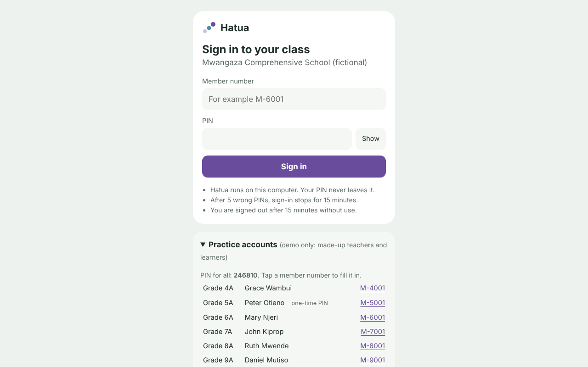

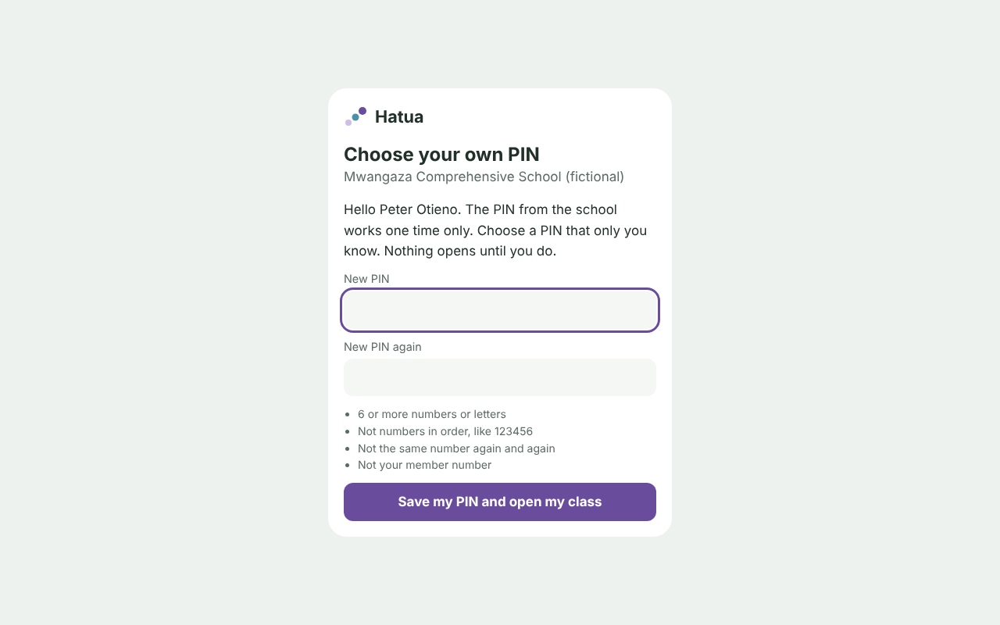

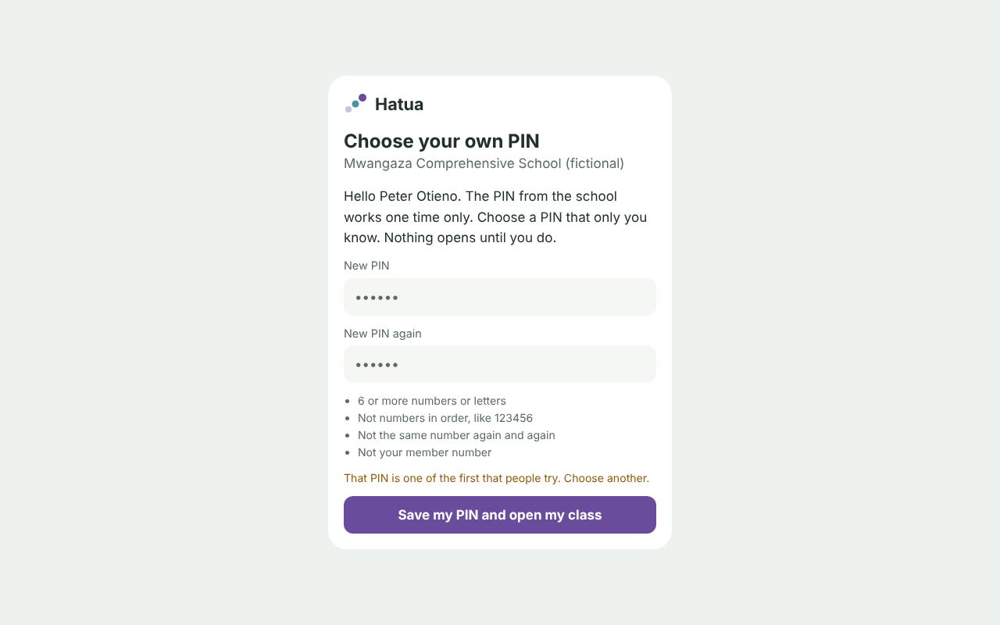

**What to say:** "The school gives each teacher a PIN that works one time. Nothing about a child opens until the teacher has a PIN only they know. Easy PINs are refused."

**More to show**

- Press **Sign out**. Sign in as `M-6001` with a **wrong** PIN one time, then the right PIN `246810`. Hatua warns: "1 wrong PIN was tried on your member number."
- Press **My account**. You see every sign-in and every wrong PIN, with the time.
- After 5 wrong PINs, sign-in stops for 15 minutes.
- If you do not touch Hatua for 15 minutes, it signs you out and clears the screen.
- One member number works in one place at a time. A new sign-in ends the old one.

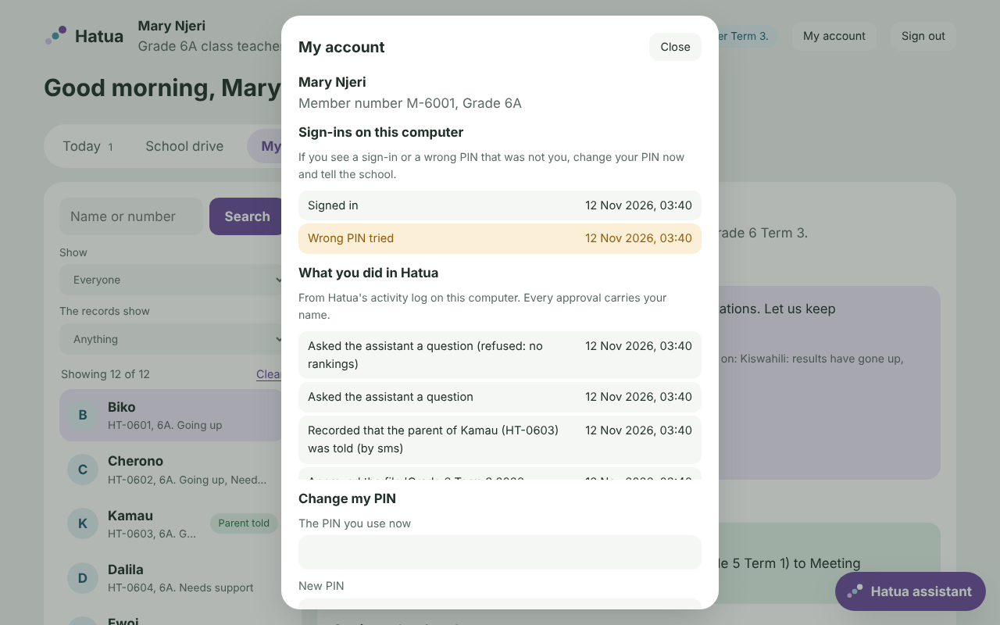

### Step 2. The class folders, with an Excel file for each term

**Where it is:** the **School drive** tab. On your Mac the folders are inside `the-long-view/demo_school/school_drive`. The code is in `hatua/drive.py` and `hatua/xlsx.py`.

**What to do**

1. Sign in as `M-6001`. Open the **School drive** tab.
2. Look at the three cards: Term 1, Term 2, Term 3.
3. To see the real folders, open a **second** Terminal window and type:

```
open ~/the-long-view/demo_school/school_drive
```

Finder opens. You see a folder for each grade. Inside each one are the folders `2026 Term 1`, `2026 Term 2` and `2026 Term 3`. Each has one Excel file. You can open the file in Excel or Numbers.

**What you will see**

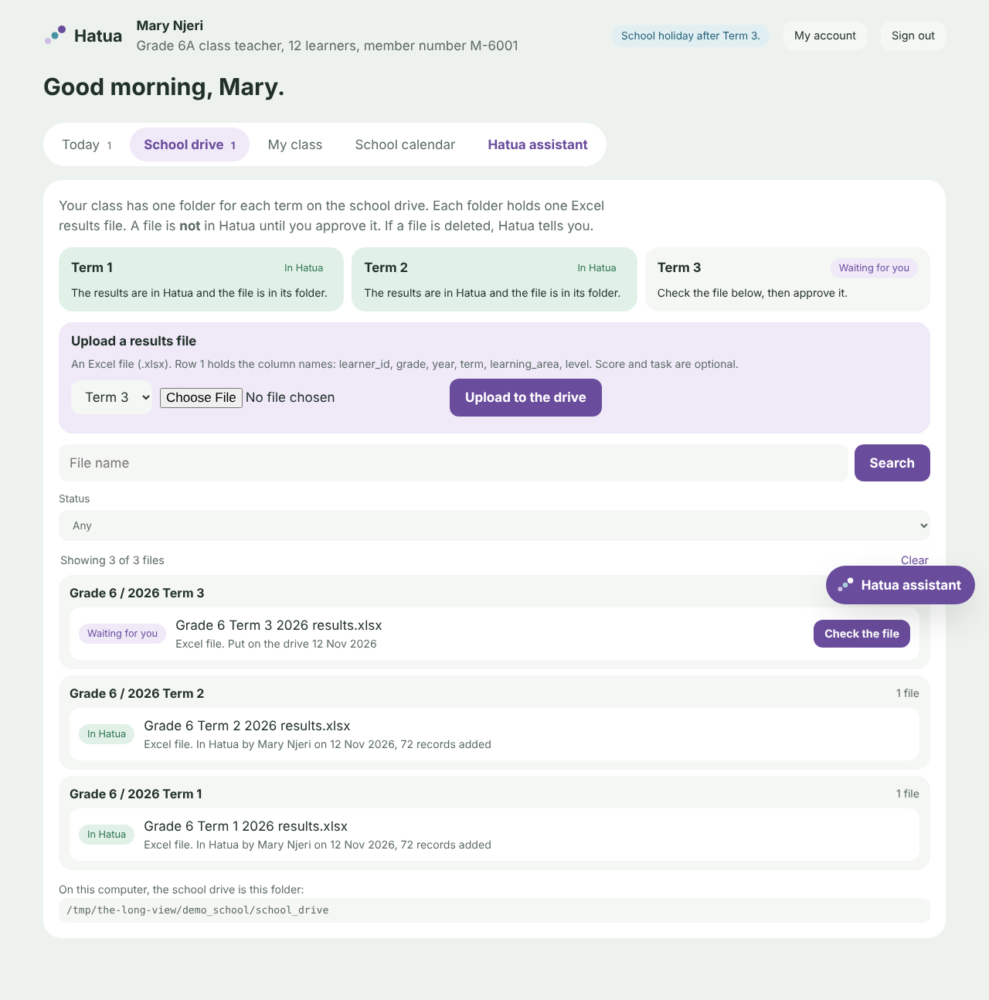

### Step 3. Delete a file. The right teacher is told.

This is the practical test.

**What to do**

1. In Finder, open `Grade 6`, then `2026 Term 1`.
2. Drag `Grade 6 Term 1 2026 results.xlsx` to your **Desktop**. (You can also delete it. Moving it to the Desktop lets you put it back.)
3. Click on the Hatua window in your browser.

**What you will see**

- A black message at the bottom: "Term 1 results file for 6A is gone from the school drive."
- The Term 1 card turns amber and says **File gone**.
- The **Today** tab has a new card. It names the file and the day Mary approved it.

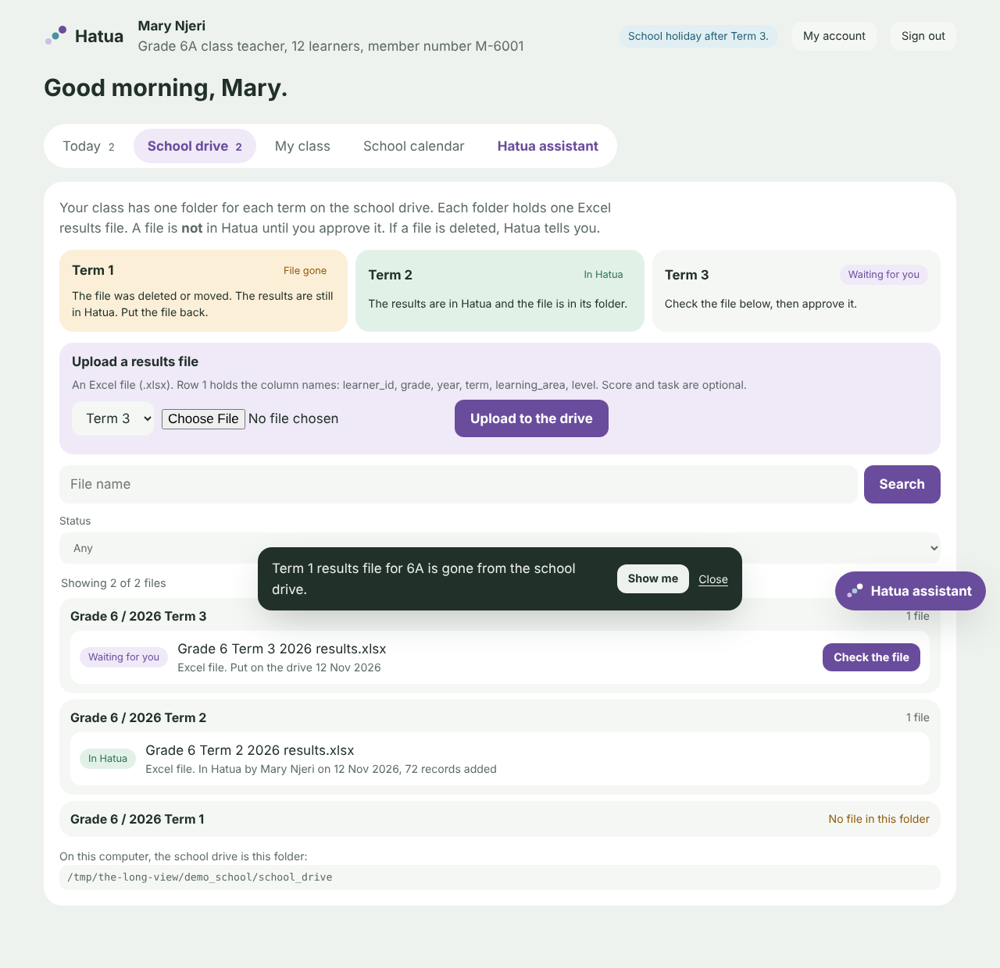

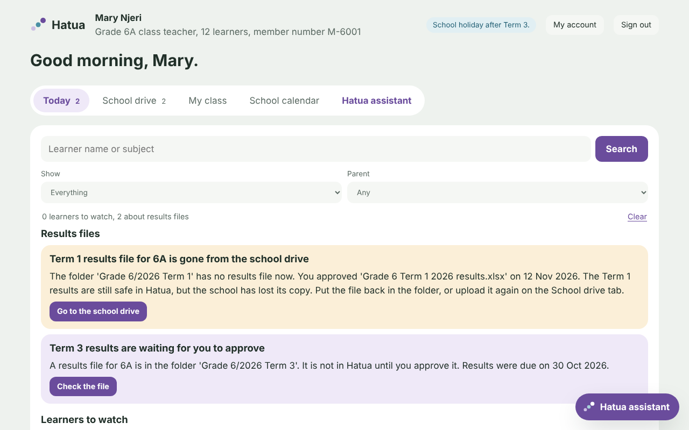

**Now show that only the right teacher is told**

1. Press **Sign out**. Sign in as `M-8001` (Grade 8).
2. The Grade 8 teacher has **no** message about the Grade 6 file.

**Show a file that was never uploaded**

1. Sign in as `M-7001` (Grade 7). The **Today** tab says "Term 3 results file for 7A is missing".
2. This teacher never uploaded Term 3. Hatua knows the due date from Kenya's school calendar.

**Put the file back**

1. Sign in as `M-6001`. Open **School drive**.
2. Choose **Term 1**, choose the file from your Desktop, press **Upload to the drive**.
3. The card turns green again and the message on **Today** goes away. Hatua knows it is the same file, so it does not ask for a second approval.

**What to say:** "Hatua checks the folders each time a teacher opens it. It tells only the class teacher of that class. The results stay safe in Hatua, but the school is told that its copy is gone."

**One honest limit:** Hatua checks when a teacher signs in, opens the Today or School drive tab, or comes back to the Hatua window. It does not send an SMS.

### Step 4. A teacher approves a file before Hatua uses it

**Where it is:** **School drive** tab, **Check the file** button.

**What to do**

1. As `M-6001`, find the Term 3 file. It says **Waiting for you**.
2. Press **Check the file**. Hatua shows how many rows are for this class.
3. Press **Approve and add to Hatua**.

**What you will see**

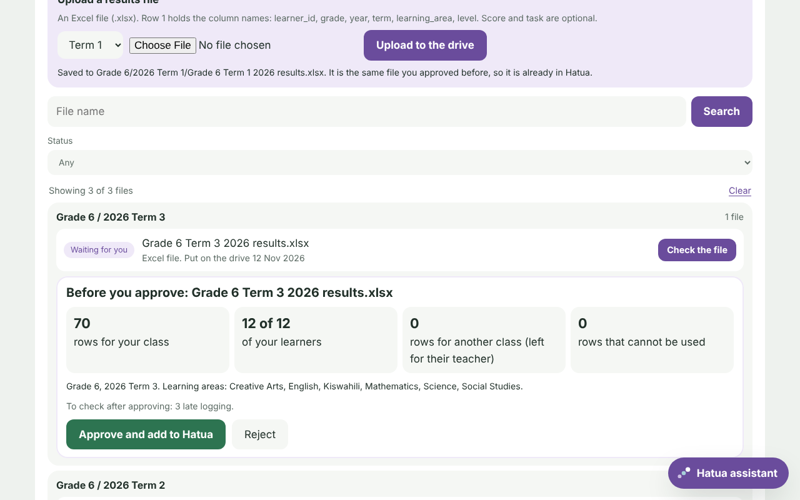

A message says: "Added 70 records to Hatua. 2 alerts about learners who need attention."

**What to say:** "A file on the drive is not in Hatua. A named teacher must approve it. Only that teacher's own learners are added."

### Step 5. Alerts, and what to tell the parent

**Where it is:** the **Today** tab.

**What to do**

1. Press **Show me** on the message, or open **Today**.
2. Read the two cards: Kamau fell two levels in Mathematics. Atieno has gone down in English over several terms.
3. Press **Message for the parent**. Press **Kiswahili**.
4. Press **I have told the parent**.

**What you will see**

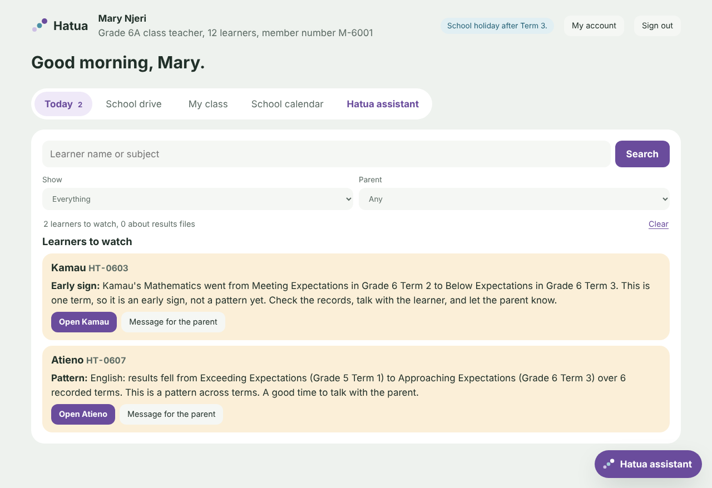

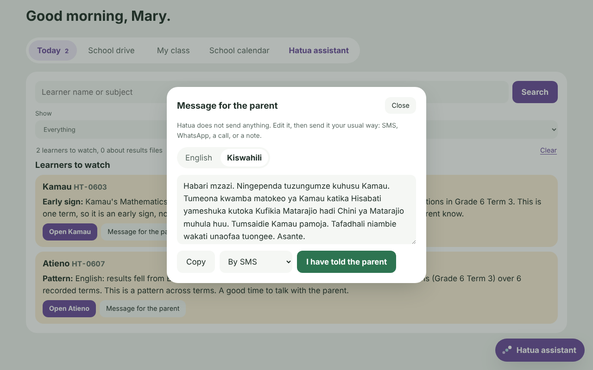

**What to say:** "Hatua sends nothing. The teacher sends the message their own way and records that the parent was told."

### Step 6. One learner across the years, with every claim sourced

**Where it is:** the **My class** tab.

**What to do**

1. Open **My class**. Tap **Kamau**.
2. Scroll to **The long view**. It shows Grade 4 to Grade 6.
3. Tap any round mark. The record behind it opens.

**What you will see**

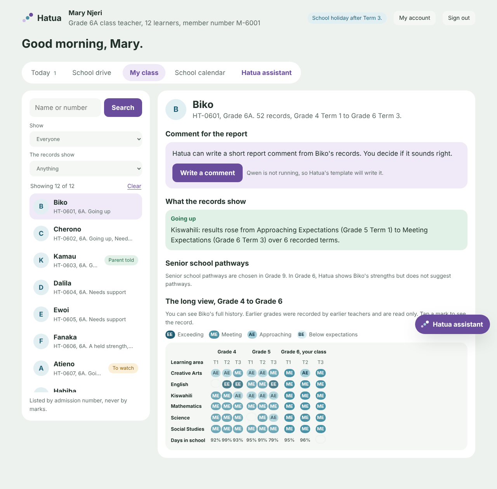

**What to say:** "Every strength and weakness links to the records it came from. Earlier grades can be read but not changed. Learners are listed by admission number, never by marks."

### Step 7. A report comment, with thumbs up or thumbs down

**What to do**

1. On a learner's page press **Write a comment**.
2. Press **Doesn't sound right**, tick **Too formal**, press **Write it again**.
3. Press **Sounds right**, then **Use this comment**.

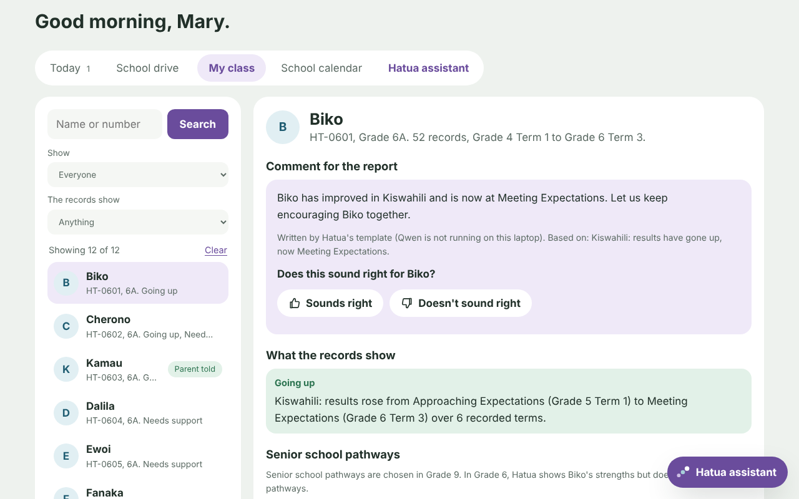

The line under the comment says who wrote it: Qwen on this laptop, or Hatua's template if Qwen is off.

### Step 8. The Hatua assistant asks one question first

**Where it is:** the **Hatua assistant** button. The code is in `hatua/assistant.py`.

**What to do**

1. Press **Hatua assistant**.
2. Type `How is Kamau doing?` and press **Ask**.
3. Hatua does not answer yet. It asks: "What do you want to know about Kamau?"
4. Tap **Only what is going down**. Now it answers, with record numbers.
5. Tap a record number to open the record.
6. Type `Who is the best in my class?`. Hatua refuses. It never ranks learners.

**What you will see**

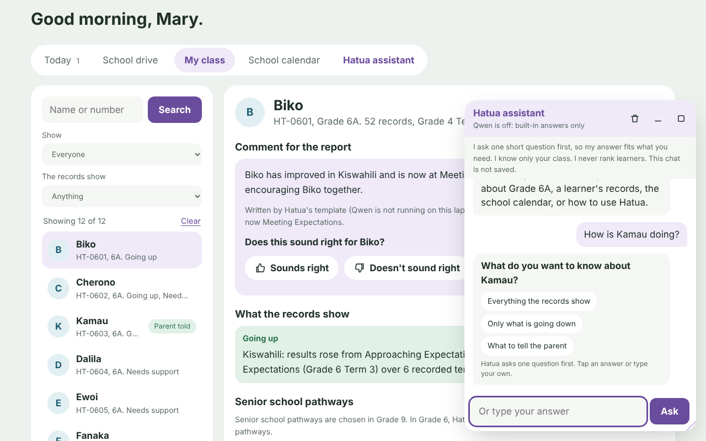

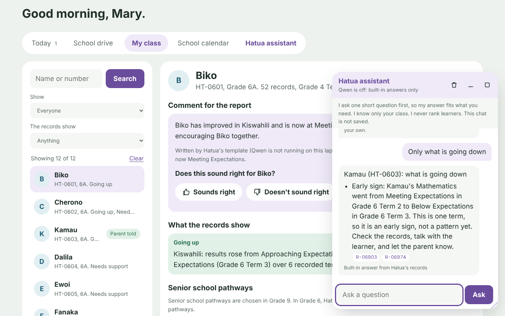

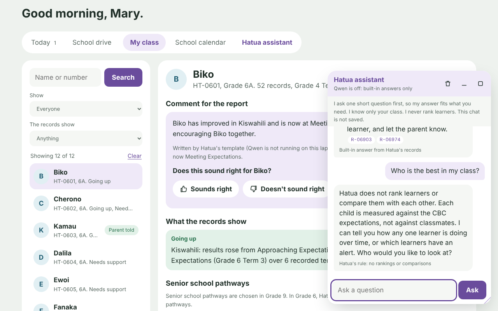

**What to say:** "The assistant always asks one short question first, even for a simple question. So the teacher gets the answer they need, and Qwen's time is not wasted. It knows only this teacher's class."

**Note:** these pictures were taken with Qwen off, so they show Hatua's built-in answers. With Ollama on, the top of the window says "Answers by qwen2.5:7b on this laptop".

### Step 9. Pathway ideas stay closed until the teacher opens them

**Where it is:** a Grade 7, 8 or 9 learner's page. The code is in `hatua/pathways.py`.

**What to do**

1. Sign in as `M-9001`. Open **My class**. Search for `Kiprono` and tap the name.
2. Scroll to **Senior school pathway ideas**. It says **Closed**.
3. Ask the assistant `What pathways could Kiprono explore?`. It will not say. It tells you to open them first.
4. Press **Open pathway ideas as Daniel Mutiso**.
5. Now you see three pathways side by side. Hatua does not pick one.
6. Press **My account**. The list says "Opened pathway ideas for Kiprono", with the time.

**What you will see**

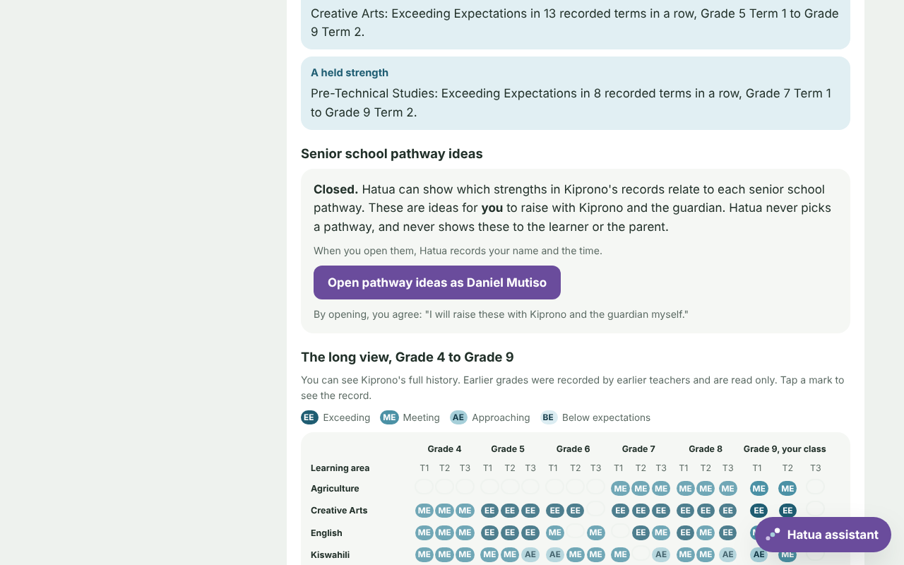

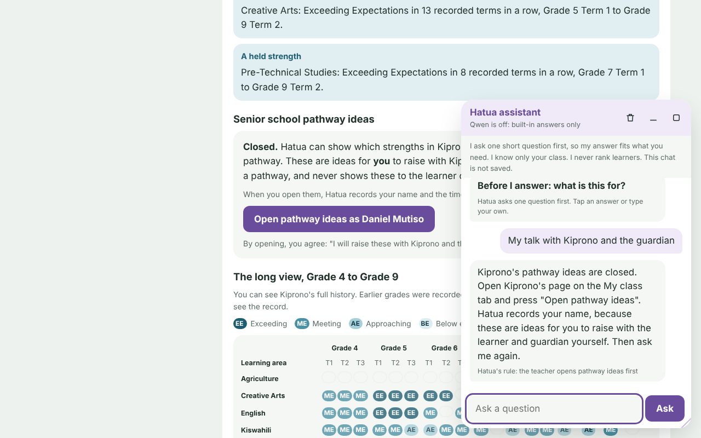

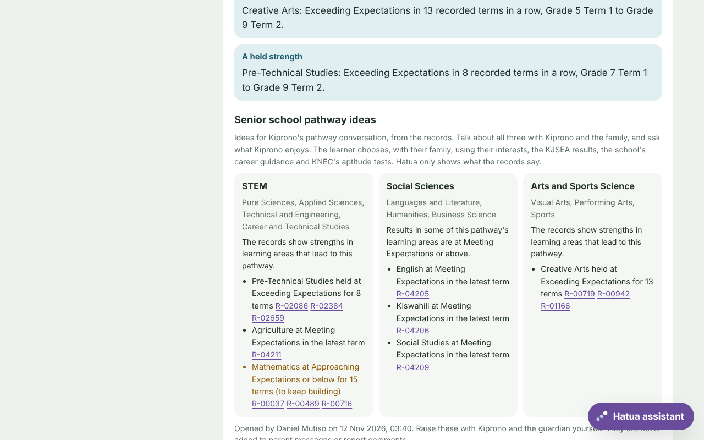

**What to say:** "The challenge says a named person must approve a pathway idea before it reaches a teacher. So they are closed. The teacher opens them with their name and promises to talk to the learner and the guardian first. Hatua shows all three pathways and never picks one. A parent message can never contain a pathway."

### Step 10. Kenya's school calendar

Open the **School calendar** tab. It shows the 2026 term dates from the Ministry of Education and the day each term's results are due.

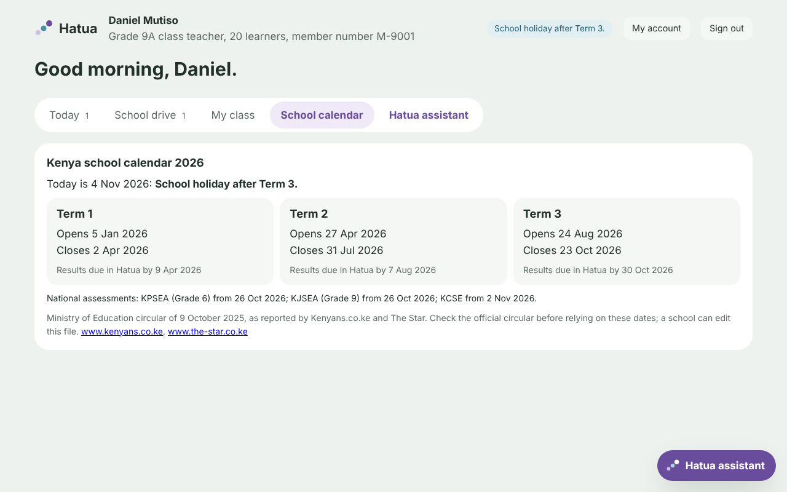

---

## Part 3. The six build requirements

The challenge says: a project that misses one of these cannot win a prize.

### 1. Your own MCP server, with 3 tools or more, and one that acts

**Where it is:** `hatua/mcp_server.py` and `hatua/tools.py`. There are 7 tools.

| Tool | What it does | Does it act? |
|---|---|---|
| `list_learners` | Lists the class | No |
| `ingest_record` | Adds a new results file to the store | **Yes** |
| `review_queue` | Lists learners with new records | No |
| `find_patterns` | Finds patterns across terms, with record numbers | No |
| `get_evidence` | Opens one record | No |
| `draft_summary` | Writes a draft for the teacher | **Yes** |
| `update_profile` | Saves a draft to the profile, only after approval | **Yes** |

**What to do:** stop the portal with `Ctrl+C` (or use a second Terminal), then type:

```
python -m hatua demo
python -m hatua agent --rules --max 2
```

**What you will see** (this is a real run):

```
Planner: rules
MCP servers: hatua, filesystem
Tools: draft_summary, find_patterns, get_evidence, get_file_info, ingest_record, list_directory, list_learners, review_queue, update_profile

  [plan] call list_directory({"path": ".../data/inbox"})
  [tool]  list_directory -> [FILE] 2026_T3_new_records.csv
  [plan] call ingest_record({"file_name": "2026_T3_new_records.csv"})
  [plan] call review_queue({"max_learners": 2})
  [plan] call find_patterns({"learner_id": "HT-0001"})
  [plan] call draft_summary({"learner_id": "HT-0001", "audience": "teacher"})
  ...
  [check] D-04be2813 HT-0001: OK

=== Paused for the class teacher. Nothing is saved until you approve. ===
```

### 2. One MCP server you did not write

**Where it is:** the official `@modelcontextprotocol/server-filesystem`. It can see only the folder `data/inbox`.

**What to show:** in the run above, the line `MCP servers: hatua, filesystem` and the tool call `list_directory`.

**The one line on why:** it is in the README under "MCP tools and servers": it is a reviewed server that already keeps the agent inside one folder, so we did not write our own.

### 3. Open-source orchestration

**Where it is:** LangGraph, in `hatua/agent.py`. The steps are: plan, tools, self-check, teacher gate.

**What to show:** `requirements.txt` (the line `langgraph`), and the `[plan]`, `[tool]`, `[check]` and "Paused" lines in the run above.

### 4. One full task on an open-weights model

**Where it is:** Qwen 2.5 7B, running on the laptop through Ollama. No data leaves the laptop.

**What to do:** start Ollama, then run the agent **without** `--rules`:

```
ollama list
python -m hatua agent --max 1
```

**What you will see:** the first line must say `Planner: ollama:qwen2.5:7b`. If it says `Planner: rules`, Ollama is not running.

**Also show:** `EVALS.md`, the part "The real Qwen run". It describes the run of 20 October 2026 on a MacBook Air.

In the portal, Qwen also writes the report comment and the assistant's answer. The page says "Written by qwen2.5:7b on this laptop".

### 5. Log every tool call. A named person approves before anything is saved or shared.

**The log**

**Where it is:** `logs/audit.jsonl`. Each line has the tool, what went in, what came out, and the time. Each line is tied to the line before it, so a change can be seen.

**What to do**

```
python -m hatua verify-log
tail -3 logs/audit.jsonl
```

**What you will see:** `OK  audit.jsonl: 98 line(s), chain intact.` (your number will differ)

For the portal, the log is in `demo_school/logs/audit.jsonl`. A teacher can read their own part under **My account**, "What you did in Hatua".

**The gates.** Each one needs a signed-in teacher. An agent cannot pass any of them.

| What is gated | Where to show it |
|---|---|
| A draft is saved to a learner's profile | The agent stops at "Paused for the class teacher". Then `python -m hatua save D-xxxx` says `BLOCKED` until the teacher approves. See `docs/DEMO.md`. |
| A results file enters Hatua | Part 2, Step 4 |
| Pathway ideas reach the teacher | Part 2, Step 9 |
| A report comment is used | Part 2, Step 7 (thumbs up) |
| Something is shared with a guardian | Part 2, Step 5. Hatua sends nothing. The teacher sends it and records it. |

### 6. New work

**Where it is:** the Git history and `CHANGELOG.md`. Type `git log --oneline | tail -5` to show the first commits.

---

## Part 4. What you must hand in

| Item | Status | Where |
|---|---|---|
| Public code, with an open licence | Done | GitHub. The licence is MIT (`LICENSE`). |
| A README that lets a stranger run it with one command | Done | `python -m hatua demo`, or `python -m hatua school-demo` for the portal |
| `ARCHITECTURE.md`, one page | Done. It is about 1,000 words. Shorten it if the judges want one printed page. | `ARCHITECTURE.md` |
| `EVALS.md`: 8 tests or more, and one failure you did not fix | Done. 21 tests. The failure: Qwen stopped after 1 of 3 learners. | `EVALS.md` |
| A demo video, under 3 minutes, public, not edited, with tool calls on screen | **You must do this** | Follow `docs/DEMO.md` |
| A text of about 300 words | **You must do this** | The challenge form |

---

## Part 5. Things that remove a project from the challenge

| The rule | How Hatua keeps it | Where to show it |
|---|---|---|
| Not a chatbot with no tools | The agent calls MCP tools by itself | Part 3, number 1 |
| Not an MCP server that only passes one call along | 7 tools with their own rules | `hatua/tools.py` |
| Never gives a child a track or a label | Hatua shows all three pathways and never picks. Label words are blocked. | Part 2, Step 9. Test E11 in `EVALS.md`. |
| No pathway idea is shared before the teacher talks to the guardian | Pathway ideas are closed, then stay with the teacher. Parent messages block pathway words. | Part 2, Step 9 |
| No claim about a learner without a source | Every claim has record numbers. An answer with a wrong record number is not shown. | Part 2, Steps 6 and 8 |
| No real learner data without consent | Everything is made up | `README.md`, `PRIVACY.md` |
| The repository must run | The tests run on every change on GitHub | The green tick on GitHub |
| No results that never happened | `EVALS.md` says what was run and what was not | `EVALS.md` |
| Learners are never ranked or compared | The assistant refuses. Lists are by admission number. | Part 2, Steps 6 and 8 |

---

## Part 6. What is not done yet

Say these things yourself. Judges give points for honesty.

- **Qwen in the portal.** The pictures in this guide were taken with Qwen off. Run the portal with Ollama on and read what Qwen writes before you show it.
- **Qwen stops early.** In the one real run, Qwen wrote for 1 of 3 learners and stopped. A rule-based helper finished the work. We have not measured how often this happens.
- **No teacher has tested Hatua yet.** The judges ask if you spoke to a teacher. Do this before you submit.
- **A deleted file is seen when a teacher opens Hatua.** There is no SMS and nothing runs in the background.
- **Kiswahili messages** need a check by a Kiswahili speaker.
- **Our guesses.** "Two levels down in one term" for an early sign, "7 days after the term closes" for the due date, and which subjects lead to which pathway.
- **The Excel files** were opened in LibreOffice and with a Python reader. Open one in Microsoft Excel on your Mac to be sure.
- **The deadline.** The challenge says code added after the deadline can remove a project. Ask the organisers which date they use before you add more.
